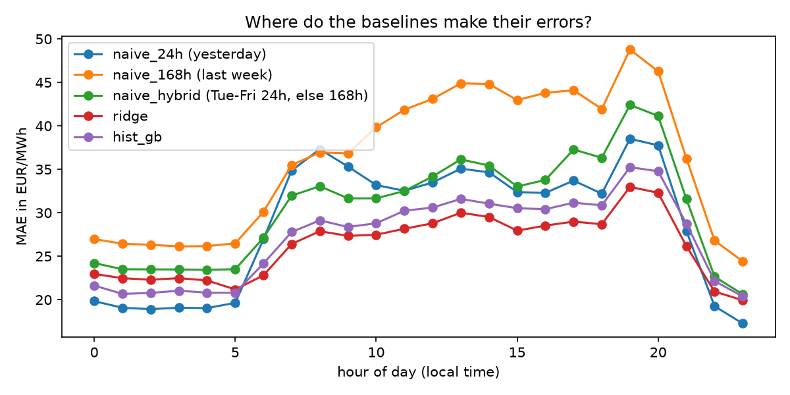
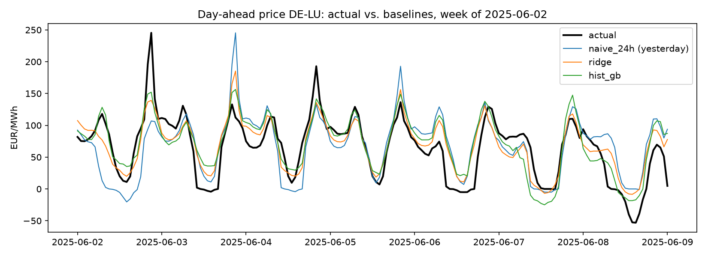
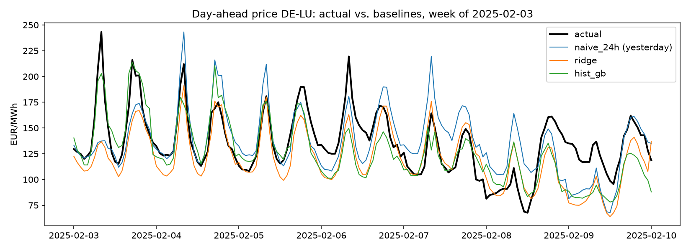

# Day-Ahead Electricity Price Forecasting (DE-LU)

A small, self-contained project that forecasts the German/Luxembourg day-ahead electricity price
hour by hour. It starts with simple baselines and adds calendar/lag features, Ridge regression and
gradient boosting, all evaluated with a leakage-free walk-forward procedure.

## Task

Every day at 12:00 the day-ahead auction closes, and the hourly prices for the next day are fixed.
The task: predict all 24 hourly prices of day *D* using only information that is available when the
auction for day *D* closes, i.e. prices up to the end of day *D-1* plus calendar information.

## Data

- Hourly day-ahead prices for the bidding zone DE-LU, 2023-01-01 to 2026-10-24, in EUR/MWh.
- Source: [Energy-Charts](https://energy-charts.info) (Fraunhofer ISE), based on data from
  Bundesnetzagentur | SMARD.de. Licensed under CC BY 4.0, please keep the attribution.
- Since 1 October 2025 the day-ahead market uses 15-minute products. The 15-minute prices are
  averaged to hourly values so that the whole history is comparable.
- The data starts in 2023 on purpose: the 2022 energy crisis had a very different price regime.
- About 5% of the hours have negative prices, and the range is -500 to 936 EUR/MWh, so percentage
  errors such as MAPE would be misleading. I use MAE and RMSE instead.

## Method

**Evaluation.** Walk-forward: for every day of the test period (2025-01-01 onward, 662 days),
the model only sees data from before that day. There is no random split, since shuffling time series
leaks future information.

**Leakage rule.** A price-based feature for hour *t* may only use prices from *t - 24 h* or earlier.
A one-hour lag would use information that does not exist at auction time.

**Baselines**
- `naive_24h`: the price at the same hour yesterday
- `naive_168h`: the price at the same hour last week
- `naive_hybrid`: yesterday on Tuesday to Friday, last week on Monday, Saturday and Sunday

**Features**
- Prices at the same hour 24 h, 48 h and 168 h earlier
- Mean price level of the last known day and the last known week
- Hour of day, weekday, a smooth yearly cycle (sine/cosine of the day of year)
- Holiday flag (German public holidays plus 24 and 31 December)

**Models**
- Ridge regression (L2 penalty, one-hot encoded hour and weekday, scaled numeric features)
- Gradient boosting (`HistGradientBoostingRegressor`)
- Both are refitted every 7 days on the last 730 days of history.

Metrics, with $n$ test hours, actual prices $y_t$ and forecasts $\hat{y}_t$:
 
$$
\text{MAE} = \frac{1}{n}\sum_{t=1}^{n}\left|y_t-\hat{y}_t\right|
$$
 
$$
\text{RMSE} = \sqrt{\frac{1}{n}\sum_{t=1}^{n}\left(y_t-\hat{y}_t\right)^2}
$$

## Results

Test period 2025-01-01 to 2026-10-24 (15,886 hours), all models compared on identical hours.

| Model | MAE (EUR/MWh) | RMSE (EUR/MWh) | MAE vs. `naive_24h` |
|---|---|---|---|
| naive_24h (yesterday) | 28.76 | 45.04 | 0.0% |
| naive_168h (last week) | 36.15 | 54.90 | -25.7% |
| naive_hybrid | 30.59 | 48.11 | -6.4% |
| **ridge** | **26.18** | **37.76** | **+9.0%** |
| hist_gb | 27.15 | 39.63 | +5.6% |

MAE by weekday:

| | Mon | Tue | Wed | Thu | Fri | Sat | Sun |
|---|---|---|---|---|---|---|---|
| naive_24h | 42.5 | 27.6 | 25.0 | 27.7 | 24.5 | 32.2 | 21.8 |
| ridge | 32.3 | 24.4 | 23.3 | 24.7 | 25.7 | 27.3 | 25.6 |
| hist_gb | 30.5 | 28.5 | 26.7 | 26.9 | 25.7 | 26.2 | 25.6 |





### What I observed

- Yesterday's price is a strong baseline. Last week's price is clearly worse, and the common
  "hybrid" benchmark did not help on this data. Week-to-week changes in weather seem to matter more
  than the weekday pattern.
- The models improve MAE by about 6 to 9% and RMSE by about 12 to 16%. The larger RMSE gain means
  they mainly reduce big misses: persistence copies a price spike one day too late.
- The gains are concentrated where "yesterday" is a different kind of day: Mondays, Saturdays and the
  evening peak. On Sundays and at night, yesterday's price is still as good or better.
- Ridge beat gradient boosting by about 1 EUR/MWh. With one test period and untuned
  hyperparameters, I would not call this a clear difference.

## Limitations

- No weather or market fundamentals yet (wind, solar and load forecasts, gas prices). Peaks and
  negative prices are still partly missed.
- Hyperparameters are reasonable defaults and not tuned.
- One test period and one split, so the results are a snapshot, not a guarantee. No significance test.
- Only point forecasts, no prediction intervals.

## Possible next steps

- Add wind, solar and load **forecasts** (not actuals) and a gas price series as features.
- Tune hyperparameters on a validation period before the test period, not on the test period.
- Test interaction features (e.g. lag × weekday) or separate models for weekdays and weekends.
- Quantile regression for probabilistic forecasts, evaluated with the pinball loss.
- Compare models with a significance test such as Diebold-Mariano.

## How to run

```bash
python -m venv .venv
.venv\Scripts\activate          # Windows; on macOS/Linux: source .venv/bin/activate
pip install -r requirements.txt
python da_price_forecast.py     # first run downloads and caches the data
python da_price_forecast.py --refresh   # force a fresh download
```

The full run takes a few minutes, mostly because of the model refits. Results will change slightly
over time, since the data range ends at the current date.

## Files

- `da_price_forecast.py`: data loading, baselines, features, models, walk-forward evaluation, plots
- `requirements.txt`: Python dependencies
- `plots/`: figures produced by the script
- `data/`: local cache of the downloaded prices (not committed)
